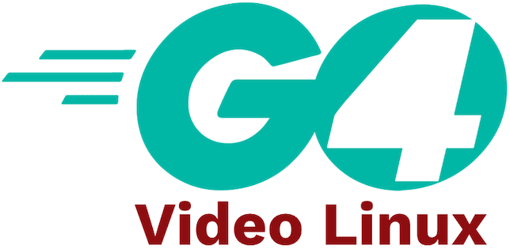

[](https://vladimirvivien.github.io/go4vl/) [](https://pkg.go.dev/github.com/vladimirvivien/go4vl) [](https://goreportcard.com/report/github.com/vladimirvivien/go4vl) [](https://github.com/vladimirvivien/go4vl/actions/workflows/test.yml) [](https://opensource.org/licenses/MIT)

# go4vl



Idiomatic Go bindings for the Linux Video4Linux2 (`V4L2`), Media Controller, and V4L2 Sub-device APIs.

----

`go4vl` provides both a low-level `v4l2` UAPI package (`CGO_ENABLED=0`) and an ergonomic `device` package with idiomatic Go streaming interfaces—including zero-copy `iter.Seq2` frame iterators (`Device.Frames(ctx)`), pooled channel capture (`Device.GetFrames()`), video output (`WriteFrame`, `WriteFramePlanes`), and stateful/stateless hardware codec helpers.

> This project targets Linux and the Linux Media / V4L2 kernel APIs only.

**Documentation Website:** [vladimirvivien.github.io/go4vl](https://vladimirvivien.github.io/go4vl/) &nbsp;|&nbsp; **API GoDoc:** [pkg.go.dev/github.com/vladimirvivien/go4vl](https://pkg.go.dev/github.com/vladimirvivien/go4vl)

## Table of Contents

- [Why go4vl?](#why-go4vl)
- [Features](#features)
- [Prerequisites](#prerequisites)
- [Installation](#installation)
- [Quick Start](#quick-start)
- [API Overview](#api-overview)
- [Examples](#examples)
- [Troubleshooting](#troubleshooting)
- [Testing](#testing)
- [Contributing](#contributing)
- [License](#license)

## Why go4vl?

Working directly with V4L2 in Go requires low-level ioctl marshaling, buffer ring bookkeeping, and architecture-specific UAPI struct layouts. `go4vl` gives you:

* **Zero-copy `iter.Seq2` streaming** - Range directly over memory-mapped kernel buffers with `dev.Frames(ctx)` (0 per-frame copies, automatic `VIDIOC_QBUF` re-queueing)
* **Idiomatic Go API** - Standard Go iterators, pooled channels, and functional options instead of raw C structs
* **No runtime CGO** - Builds with `CGO_ENABLED=0` across `linux/amd64`, `linux/arm64`, `linux/arm`, and `linux/riscv64` without kernel headers or a C toolchain
* **Capture, output, media graphs, and codecs** - Covers capture, video output, multi-planar (`MPLANE`) streams, DMA-BUF, Media Controller graphs, sub-devices, `MediaRequest` FDs, and hardware codecs

## Features

* Zero-copy frame capture via `Device.Frames(ctx)` (`iter.Seq2[*device.Frame, error]`) and pooled channel streaming via `Device.GetFrames()`
* Video output streaming (`Device.WriteFrame`, `Device.WriteFramePlanes`) and direct `Read` / `Write` I/O (`IOMethodReadWrite`)
* Single- and multi-planar (`MPLANE`) capture/output (`WithPixFormatMPlane`, `Frame.Planes`), Metadata Format API (`GetMetaFormat`/`SetMetaFormat`/`TryMetaFormat`), Selection API, UserPtr & DMA-BUF I/O, buffer lifecycle (`PrepareBuffer`, `CreateBuffers`, `RemoveBuffers`), and dual-queue M2M sessions (`v4l2.M2MSession`)
* Media Controller v2 graph topology (`MEDIA_IOC_G_TOPOLOGY`, `MEDIA_IOC_SETUP_LINK`), Media Request API (`MEDIA_IOC_REQUEST_ALLOC`), HDMI EDID (`GetEDID`/`SetEDID`), and V4L2 Sub-device pad formats & stream routing (`VIDIOC_SUBDEV_*`)
* `v4l2.Poll` and `v4l2.Poller` (`epoll` with `eventfd` cancellation) multiplexing `POLLIN | POLLOUT | POLLPRI`
* User, extended, and stateless codec controls (`H.264`, `HEVC`, `VP8`, `VP9`, `AV1`, `MPEG2`, `FWHT`) plus stateful `device.Encoder` / `device.Decoder`

## Prerequisites

**Software:**
* Go 1.26 or later
* Linux kernel 5.10 or later with V4L2 drivers
* *(Optional)* `gcc` or `clang` and Linux 6.12+ `linux-libc-dev` (or Docker with `golang:1.26-trixie`) are needed only when regenerating ABI definitions (`go generate ./v4l2`)

**Hardware:**
* V4L2-compatible capture/output device (webcam, capture card, CSI-2 pipeline, hardware codec, or `v4l2loopback`) accessible via `/dev/video*`

**Supported & Tested Platforms:**
* `linux/amd64` (x86_64 workstations and servers)
* `linux/arm64` (Raspberry Pi 4/5 64-bit OS, embedded ARM64 boards)
* `linux/arm` (32-bit ARM / Raspberry Pi OS)
* `linux/riscv64` (64-bit RISC-V Linux)

See the [Building & Cross-Compiling Guide](https://vladimirvivien.github.io/go4vl/BUILD/) ([docs/BUILD.md](./docs/BUILD.md)) for full instructions.

## Installation

```bash
go get github.com/vladimirvivien/go4vl/v4l2
```

Ensure your user belongs to the `video` group so it can open `/dev/video*` and `/dev/media*` nodes:

```bash
sudo usermod -a -G video "$USER"
# Log out and back in for group changes to take effect
```

## Building & Cross-Compiling

```bash
# Native build (no C compiler or headers required)
CGO_ENABLED=0 go build ./...

# Cross-compile static binaries for ARM64, 32-bit ARM, or RISC-V
CGO_ENABLED=0 GOOS=linux GOARCH=arm64 go build ./examples/iter_capture
CGO_ENABLED=0 GOOS=linux GOARCH=arm go build ./examples/iter_capture
CGO_ENABLED=0 GOOS=linux GOARCH=riscv64 go build ./examples/iter_capture
```

## Quick Start

Capture a single JPEG frame using the zero-copy `Frames(ctx)` iterator:

```go
package main

import (
	"context"
	"log"
	"os"

	"github.com/vladimirvivien/go4vl/device"
	"github.com/vladimirvivien/go4vl/v4l2"
)

func main() {
	dev, err := device.Open("/dev/video0",
		device.WithBufferSize(4),
		device.WithPixFormat(v4l2.PixFormat{
			Width:       640,
			Height:      480,
			PixelFormat: v4l2.PixelFmtMJPEG,
		}),
	)
	if err != nil {
		log.Fatal(err)
	}
	defer dev.Close()

	ctx := context.Background()
	if err := dev.Start(ctx); err != nil {
		log.Fatal(err)
	}
	defer dev.Stop()

	for frame, err := range dev.Frames(ctx) {
		if err != nil {
			log.Fatal(err)
		}
		if err := os.WriteFile("pic.jpg", frame.Data, 0o644); err != nil {
			log.Fatal(err)
		}
		break // Underlying MMAP buffer is automatically re-queued on break.
	}
}
```

See complete examples: [examples/iter_snapshot](./examples/iter_snapshot/) and [examples/iter_capture](./examples/iter_capture/).

## API Overview

Full conceptual guides live at **[vladimirvivien.github.io/go4vl](https://vladimirvivien.github.io/go4vl/)** and generated GoDocs live on **[pkg.go.dev](https://pkg.go.dev/github.com/vladimirvivien/go4vl)**:

* **Device discovery & options:**
```go
paths, _ := device.GetAllDevicePaths()
fmt.Println(paths)

dev, err := device.Open("/dev/video0",
	device.WithBufferSize(4),
	device.WithPixFormat(v4l2.PixFormat{PixelFormat: v4l2.PixelFmtMJPEG}),
)
defer dev.Close()
```

* **Format control:**
```go
formats, _ := dev.GetFormatDescriptions()
currFmt, err := dev.GetPixFormat()
currFmt.PixelFormat = v4l2.PixelFmtYUYV
if err := dev.SetPixFormat(currFmt); err != nil {
	log.Fatal(err)
}
```

* **Device controls:**
```go
ctrl, err := dev.GetControl(v4l2.CtrlBrightness)
if err == nil {
	_ = dev.SetControlValue(v4l2.CtrlBrightness, ctrl.Default)
}
```

* **Streaming (`Device.Frames` or `Device.GetFrames`):**
```go
for frame, err := range dev.Frames(ctx) {
	if err != nil {
		log.Fatal(err)
	}
	// frame.Data aliases the MMAP buffer (0 copies). Use frame.Clone() to retain data.
	processFrame(frame.Data)
}
```

## Examples

The [`examples/`](./examples/README.md) directory ships over 40 runnable programs—including `iter_capture`, `iter_snapshot`, `mplane_device`, `video_output`, `m2m_pipeline`, `mplane_capture`, `meta_capture`, `selection_crop`, `media_topology`, `subdev_pipeline`, `media_request`, `stateless_hevc`, `h264_encoder`, `h264_decoder`, `simplecam`, and `webcam`.

Browse categorized listings on the [Examples page](https://vladimirvivien.github.io/go4vl/examples/) or in [examples/README.md](./examples/README.md).

## Troubleshooting

* **Device not found:** Run `ls -l /dev/video*` or `v4l2-ctl --list-devices`.
* **Permission denied:** Add your user to `video` (`sudo usermod -a -G video "$USER"` and log back in).
* **No frames received:** Inspect hardware capabilities and formats with `v4l2-ctl -d /dev/video0 --all` and `v4l2-ctl -d /dev/video0 --list-formats-ext`.
* **ABI regeneration errors:** Install Linux 6.12+ headers (`sudo apt-get install build-essential linux-libc-dev`) or run code generation inside Docker — see [docs/BUILD.md](./docs/BUILD.md#regenerating-uapi-definitions-contributors).

## Testing

```bash
# Unit tests and vet (no CGO or video hardware required)
CGO_ENABLED=0 go test -v ./v4l2 ./device
CGO_ENABLED=0 go vet ./v4l2 ./device

# Integration tests (requires v4l2loopback or a /dev/video* device)
CGO_ENABLED=0 go test -v -tags=integration ./test/... -args -use-device-emulation=auto -require-streaming
```

See [TESTING_GUIDE.md](./TESTING_GUIDE.md) and the [Testing & CI Guide](https://vladimirvivien.github.io/go4vl/guides/testing/) for loopback setup, flags, and benchmarks.

## Contributing

Contributions are welcome. Ensure `CGO_ENABLED=0 go test ./v4l2 ./device`, `CGO_ENABLED=0 go vet ./...`, and multi-arch builds (`amd64`, `arm64`, `arm`, `riscv64`) pass before opening a Pull Request. Report issues via [GitHub Issues](https://github.com/vladimirvivien/go4vl/issues) and check [GitHub Releases](https://github.com/vladimirvivien/go4vl/releases) for versioned release notes.

## License

MIT License — see [LICENSE](LICENSE). Copyright (c) 2021 Vladimir Vivien.
