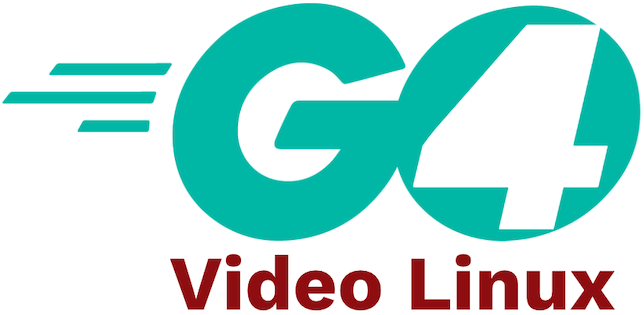

[](https://pkg.go.dev/github.com/vladimirvivien/go4vl) [](https://goreportcard.com/report/github.com/vladimirvivien/go4vl) [](https://github.com/vladimirvivien/go4vl/actions/workflows/test.yml) [](https://opensource.org/licenses/MIT)

# go4vl



A Go centric abstraction of the library for  `Video for Linux 2`  (v4l2) user API.

----

The `go4vl` project is for working with the Video for Linux 2 API for real-time video.
It provides both a low-level `v4l2` UAPI package (`CGO_ENABLED=0`) and an ergonomic `device` package with idiomatic Go streaming interfaces—including zero-copy `iter.Seq2` frame iterators (`Device.Frames(ctx)`) and channels.

> This project is designed to work with Linux and the Linux Video API only.  It is *NOT* meant to be a portable/cross-platform package.

## Table of Contents

- [Why go4vl?](#why-go4vl)
- [Features](#features)
- [Prerequisites](#prerequisites)
- [Installation](#installation)
- [Quick Start](#quick-start)
- [API Overview](#api-overview)
- [Examples](#examples)
- [Troubleshooting](#troubleshooting)
- [Testing](#testing)
- [Contributing](#contributing)
- [License](#license)
- [Roadmap](#roadmap)

## Why go4vl?

Working directly with V4L2 in Go requires complex ioctl marshaling and manual memory management. `go4vl` provides:

* **Zero-copy `iter.Seq2` streaming** - Range directly over memory-mapped kernel buffers with `dev.Frames(ctx)` (0 per-frame copies, automatic `VIDIOC_QBUF` re-queueing)
* **Idiomatic Go API** - Standard Go iterators, channels, and typed options instead of raw C structs
* **No runtime CGO** - Builds with `CGO_ENABLED=0` on Linux (`amd64` and `arm64`) without kernel headers or a C toolchain
* **Capture, output, and M2M pipelines** - Supports video capture, video output, multi-planar (`MPLANE`) formats, DMA-BUF export/import, and `epoll`/`poll` multiplexing

## Features

* Zero-copy frame capture via `Device.Frames(ctx)` (`iter.Seq2[*device.Frame, error]`) as well as channel APIs (`GetFrames()`, `GetOutput()`)
* Video output streaming (`Device.WriteFrame`) and direct `Read` / `Write` I/O
* Multi-planar (`MPLANE`) formats/buffers, Selection API, DMA-BUF, and dual-queue M2M sessions (`v4l2.M2MSession`)
* Media Controller v2 graph topology (`MEDIA_IOC_G_TOPOLOGY`, `MEDIA_IOC_SETUP_LINK`), Media Request API (`MEDIA_IOC_REQUEST_ALLOC`), and V4L2 Sub-device pad SDK (`VIDIOC_SUBDEV_*`)
* `v4l2.Poll` and `v4l2.Poller` (`epoll`) multiplexing `POLLIN | POLLOUT | POLLPRI`
* Device enumeration, format negotiation, and user/extended/codec controls

## Prerequisites

**Software:**
* Go 1.26 or later
* Linux kernel 5.10.x or later
* V4L2 drivers (typically included in the Linux kernel)
* *(Optional)* A C compiler and `linux-libc-dev` are only needed if regenerating ABI definitions (`go generate ./v4l2`) or running `-tags=cgo_verify` parity tests

**Hardware:**
* V4L2-compatible capture device (webcam, capture card, etc.)
* Device accessible via `/dev/videoX`

**Tested platforms:**
* Raspberry Pi 3/4 (32-bit and 64-bit Raspberry Pi OS)
* x86_64 Linux distributions
* ARM Linux systems with V4L2 support

See [docs/BUILD.md](./docs/BUILD.md) for comprehensive build instructions including prerequisite installation, cross-compilation, and troubleshooting.

## Installation

```bash
go get github.com/vladimirvivien/go4vl/v4l2
```

Ensure your user has access to video devices:
```bash
sudo usermod -a -G video $USER
# Log out and back in for changes to take effect
```

**Note**: For detailed build instructions, cross-compilation, and ABI verification, see [docs/BUILD.md](./docs/BUILD.md).

## Building

`go4vl` builds with `CGO_ENABLED=0` on Linux (`amd64` and `arm64`) with no C compiler or kernel headers required:

```bash
# Build all packages and examples
CGO_ENABLED=0 go build ./...

# Cross-compile for 64-bit ARM (e.g., Raspberry Pi)
CGO_ENABLED=0 GOOS=linux GOARCH=arm64 go build ./examples/iter_capture
```

See [docs/BUILD.md](./docs/BUILD.md) for cross-compilation, Docker builds, and optional ABI regeneration (`go generate ./v4l2`).

## Quick Start

Capture a single frame and save to file using the zero-copy `Frames(ctx)` iterator:

```go
package main

import (
	"context"
	"log"
	"os"

	"github.com/vladimirvivien/go4vl/device"
)

func main() {
	dev, err := device.Open("/dev/video0", device.WithBufferSize(2))
	if err != nil {
		log.Fatal(err)
	}
	defer dev.Close()

	ctx := context.Background()
	if err := dev.Start(ctx); err != nil {
		log.Fatal(err)
	}
	defer dev.Stop()

	for frame, err := range dev.Frames(ctx) {
		if err != nil {
			log.Fatal(err)
		}
		if err := os.WriteFile("pic.jpg", frame.Data, 0o644); err != nil {
			log.Fatal(err)
		}
		break // Underlying MMAP buffer is automatically re-queued on break.
	}
}
```

See complete examples: [examples/iter_snapshot/main.go](./examples/iter_snapshot/main.go) and [examples/iter_capture/main.go](./examples/iter_capture/main.go)

## API Overview

**Core packages:**
* **`device`** - High-level device operations (open, start, capture, close)
* **`v4l2`** - Low-level V4L2 types and ioctls
* **`imgsupport`** - Image format conversion utilities

**Key concepts:**

**Device management:**
```go
// List available devices
devices := device.GetAllDevices()

// Open device with options
dev, err := device.Open("/dev/video0",
    device.WithBufferSize(4),
    device.WithPixFormat(v4l2.PixFormat{PixelFormat: v4l2.PixelFmtMJPEG}),
)
defer dev.Close()
```

**Format control:**
```go
// Query supported formats
formats := dev.GetFormatDescriptions()

// Set pixel format
currFmt, err := dev.GetPixFormat()
currFmt.PixelFormat = v4l2.PixelFmtYUYV
if err := dev.SetPixFormat(currFmt); err != nil {
    log.Fatal(err)
}
```

**Device controls:**
```go
// Get control value
brightness := dev.GetControl(v4l2.CtrlBrightness)

// Set control value
dev.SetControl(v4l2.CtrlBrightness, 128)
```

**Streaming (Zero-Copy `Frames` Iterator — Recommended):**
```go
ctx := context.Background()
if err := dev.Start(ctx); err != nil {
    log.Fatal(err)
}
defer dev.Stop()

for frame, err := range dev.Frames(ctx) {
    if err != nil {
        log.Fatal(err)
    }

    // frame.Data points directly into the MMAP buffer (0 copies, 0 allocs).
    // The buffer is automatically re-queued after each iteration (including on break/return).
    processFrame(frame.Data)

    // To retain frame data beyond the current iteration, clone it:
    // saved := frame.Clone()
}
```

`Device.Frames(ctx)` uses Go's `iter.Seq2[*device.Frame, error]` backed by `v4l2.Poll` with no background goroutines and automatic `VIDIOC_QBUF` buffer bookkeeping. See [examples/iter_capture](./examples/iter_capture/) and [examples/iter_snapshot](./examples/iter_snapshot/).

**Streaming (Pooled Channel API):**
```go
ctx := context.Background()
dev.Start(ctx)

for frame := range dev.GetFrames() {
    // Access frame data with metadata
    processFrame(frame.Data)

    // Access metadata
    log.Printf("Frame %d captured at %v", frame.Sequence, frame.Timestamp)

    // Check frame type (for compressed formats like MJPEG, H.264)
    if frame.IsKeyFrame() {
        log.Printf("Keyframe detected")
    }

    // IMPORTANT: Release buffer back to pool
    frame.Release()
}
```

**Streaming (Legacy Channel API):**
```go
ctx := context.Background()
dev.Start(ctx)

for frame := range dev.GetOutput() {
    processFrame(frame)
}
```

Full API documentation: [pkg.go.dev/github.com/vladimirvivien/go4vl](https://pkg.go.dev/github.com/vladimirvivien/go4vl)

## Examples

This repository includes multiple examples demonstrating various capabilities:

* **[iter_capture](./examples/iter_capture/)** - **Recommended**: Zero-copy frame capture using `Device.Frames(ctx)` (`iter.Seq2`)
* **[iter_snapshot](./examples/iter_snapshot/)** - Single-frame snapshot using `Device.Frames(ctx)`
* **[video_output](./examples/video_output/)** - Stream frames to a V4L2 video output or `v4l2loopback` device
* **[m2m_pipeline](./examples/m2m_pipeline/)** - Dual-queue M2M (`OUTPUT` + `CAPTURE`) session with `v4l2.Poller` (`epoll`)
* **[mplane_capture](./examples/mplane_capture/)** - Multi-planar (`MPLANE`) formats, plane buffers, and DMA-BUF export
* **[selection_crop](./examples/selection_crop/)** - Selection API (`VIDIOC_G_SELECTION` / `VIDIOC_S_SELECTION`)
* **[media_topology](./examples/media_topology/)** - Inspect `/dev/media*` entities, interfaces, pads, and links via `MEDIA_IOC_G_TOPOLOGY`
* **[subdev_pipeline](./examples/subdev_pipeline/)** - Query and negotiate `/dev/v4l-subdev*` pad formats, media-bus codes, and selections
* **[media_request](./examples/media_request/)** - Allocate, reinitialize, and bind Media Request FDs for stateless codecs
* **[capture_frames](./examples/capture_frames/)** - Channel-based capture with metadata and buffer pooling
* **[snapshot](./examples/snapshot/)** - Single-frame capture (legacy channel API)
* **[device_info](./examples/device_info/)** - Query device information
* **[format](./examples/format/)** - Query and set formats
* **[user_ctrl](./examples/user_ctrl/)** - Control brightness, contrast, etc.
* **[ext_ctrls](./examples/ext_ctrls/)** - Extended codec controls
* **[simplecam](./examples/simplecam/)** - Web streaming camera
* **[webcam](./examples/webcam/)** - Full-featured webcam with controls

Full examples list: [examples/README.md](./examples/README.md)

## Troubleshooting

**Device not found:**
```bash
# List available video devices
ls -l /dev/video*

# Check device info
v4l2-ctl --list-devices
```

**Permission denied:**
```bash
# Add user to video group
sudo usermod -a -G video $USER
# Log out and back in

# Or temporarily
sudo chmod 666 /dev/video0
```

**No frames received:**
```bash
# Verify device capabilities
v4l2-ctl -d /dev/video0 --all

# Check supported formats
v4l2-ctl -d /dev/video0 --list-formats-ext
```

**ABI regeneration / `cgo_verify` errors:**
```bash
# Only needed if running `go generate ./v4l2` or `-tags=cgo_verify`
sudo apt install build-essential linux-libc-dev
```

## Testing

`go4vl` includes unit tests, C ABI parity verification, and integration tests using `v4l2loopback` or real V4L2 hardware.

```bash
# Run unit tests (no CGO or kernel headers required)
CGO_ENABLED=0 go test -v ./device ./v4l2 ./imgsupport

# Verify generated ABI layouts against host Linux headers
CGO_ENABLED=1 go test -v -tags=cgo_verify ./v4l2 -run TestABI

# Run integration tests (requires v4l2loopback or a /dev/video* device)
CGO_ENABLED=0 go test -v -tags=integration ./test/...
```

See [TESTING_GUIDE.md](./TESTING_GUIDE.md) for comprehensive testing documentation including:
* v4l2loopback setup
* Virtual device configuration
* CI/CD integration
* Docker-based testing

## Contributing

Contributions are welcome! To contribute:

1. Fork the repository
2. Create a feature branch (`git checkout -b feature/amazing-feature`)
3. Commit your changes (`git commit -m 'Add amazing feature'`)
4. Push to the branch (`git push origin feature/amazing-feature`)
5. Open a Pull Request

Please ensure:
* Code follows Go conventions (`go fmt`, `go vet`)
* Tests pass (`go test ./...`)
* New features include tests
* Documentation is updated

Report bugs and request features via [GitHub Issues](https://github.com/vladimirvivien/go4vl/issues).

## License

This project is licensed under the MIT License - see the [LICENSE](LICENSE) file for details.

Copyright (c) 2021 Vladimir Vivien

## Roadmap

The main goal is to port as many V4L2 functionalities as possible so that adopters can use Go to create video-based tools on platforms such as the Raspberry Pi and other Linux systems.

**Current focus:**
* Extended codec controls (H.264, VP8, MPEG2)
* Advanced streaming modes
* Performance optimizations
* Broader device compatibility testing
