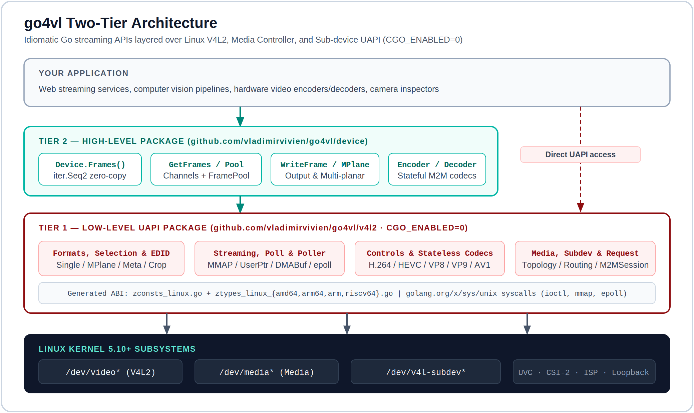

# Welcome to `go4vl`

`go4vl` brings the Linux Video4Linux2 (`V4L2`), Media Controller, and V4L2 Sub-device subsystems to Go without runtime CGO or kernel-header dependencies. You use it to capture live frames from webcams and CSI-2 camera sensors, emit frames to virtual or hardware video outputs, configure media pipeline topologies, and drive hardware codecs cleanly from idiomatic Go code.

Because `go4vl` targets Linux kernel userspace APIs directly through `golang.org/x/sys/unix` and checked-in UAPI definitions, your applications cross-compile with `CGO_ENABLED=0` across `linux/amd64`, `linux/arm64`, `linux/arm`, and `linux/riscv64`.

!!! note "Linux-only by design"
    Video4Linux2 is a Linux kernel subsystem. `go4vl` intentionally targets Linux systems (`kernel 5.10+`) rather than abstracting non-Linux camera frameworks.

## Two-tier package design

Rather than forcing every application to marshal low-level `ioctl` structs, `go4vl` splits functionality across two packages that compose together:

* **[`device`](https://pkg.go.dev/github.com/vladimirvivien/go4vl/device) (High-level package)** wraps open/close lifecycles, format negotiation, buffer allocation, and streaming behind functional options, the `Device.Frames(ctx)` zero-copy iterator (`iter.Seq2`), the `Device.GetFrames()` channel API, video output helpers (`WriteFrame`, `WriteFramePlanes`), and stateful hardware codec wrappers (`Encoder`, `Decoder`).
* **[`v4l2`](https://pkg.go.dev/github.com/vladimirvivien/go4vl/v4l2) (Low-level UAPI package)** exposes the underlying Linux structures, constants, and `ioctl` helpers directly—including single- and multi-planar formats, metadata streams, selection rectangles, extended and stateless codec controls, `Poll`/`Poller` (`epoll`), `M2MSession`, `/dev/media*` topology discovery, `/dev/v4l-subdev*` routing, `MediaRequest` FDs, and HDMI EDID blocks.

Start with `device` for standard video capture and output workflows. Reach for `v4l2` whenever you need custom `ioctl` control, sub-device pipeline configuration, multi-FD `epoll` multiplexing, or direct `MediaRequest` orchestration.

## Where to go next

Choose the path that matches what you want to do first:

* **[Installation & Permissions](install.md)** sets up Go 1.26+, adds the module, and grants non-root access to `/dev/video*` and `/dev/media*`.
* **[Quick Start](quickstart.md)** captures your first JPEG frame with `Device.Frames(ctx)`.
* **[Streaming, I/O & Zero-Copy](../guides/streaming.md)** compares `Frames(ctx)` against `GetFrames()`, covers MMAP, UserPtr, DMA-BUF, and `Read`/`Write` modes, and introduces `v4l2.Poll` / `v4l2.Poller`.
* **[Examples Overview](../examples/index.md)** indexes over 40 runnable programs across camera capture, Media Controller graphs, sub-device routing, and hardware codecs.
