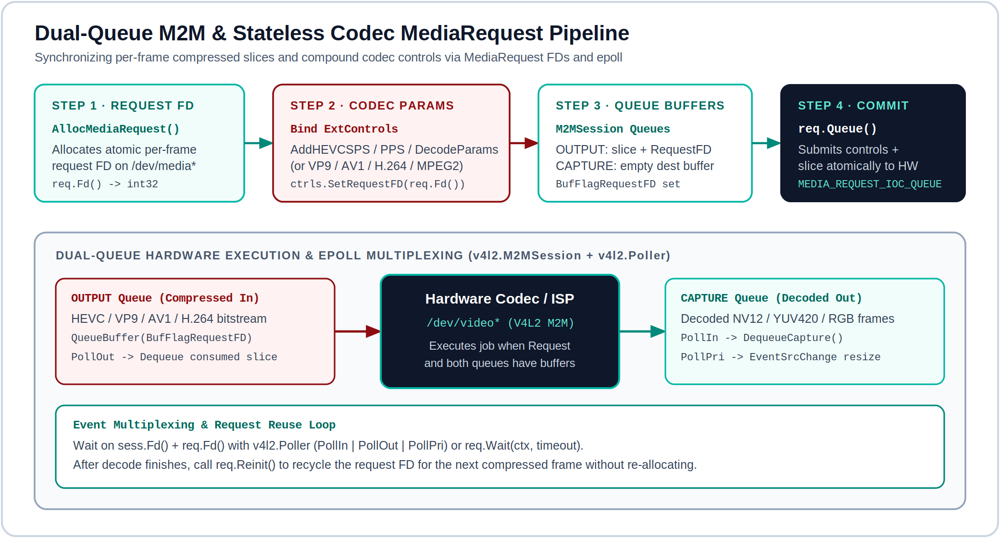

# Codecs & Memory-to-Memory Pipelines

Hardware scalers, color-space converters, ISPs, and video encoders/decoders operate as V4L2 memory-to-memory (`M2M`) devices with **two independent buffer queues** on a single file descriptor: an `OUTPUT` queue accepting input frames or compressed bitstreams from your application, and a `CAPTURE` queue emitting processed or decoded buffers back to your application. `go4vl` provides both stateful high-level `Encoder`/`Decoder` wrappers and low-level `M2MSession` + `MediaRequest` primitives for stateless decoders.



## Stateful hardware encoding and decoding (`device.Encoder` / `device.Decoder`)

For stateful V4L2 M2M hardware (such as Raspberry Pi's stateful H.264 encoder/decoder), `device.OpenEncoder` and `device.OpenDecoder` manage dual-queue formats, MMAP buffers, codec commands (`Start`, `Drain`, `Flush`, `Stop`), and resolution-change events behind Go channels:

```go
enc, err := device.OpenEncoder("/dev/video11", device.EncoderConfig{
	InputFormat: v4l2.PixFormat{
		Width:       1280,
		Height:      720,
		PixelFormat: v4l2.PixelFmtYUV420,
	},
	OutputFormat: v4l2.PixFormat{
		PixelFormat: v4l2.PixelFmtH264,
	},
	Bitrate: 2_000_000,
	GOPSize: 30,
})
if err != nil {
	log.Fatal(err)
}
defer enc.Close()

if err := enc.Start(ctx); err != nil {
	log.Fatal(err)
}

go func() {
	enc.GetInput() <- rawYUVFrame
	_ = enc.Drain() // signal end of stream via V4L2_ENC_CMD_STOP
}()

for pkt := range enc.GetOutput() {
	writeH264(pkt)
}
```

When decoding streams that change resolution dynamically mid-stream (`V4L2_EVENT_SOURCE_CHANGE`), `Decoder` surfaces typed geometry updates through `dec.GetResolutionChanges()`. See `examples/h264_encoder/` and `examples/h264_decoder/`.

## Low-level dual-queue M2M with `v4l2.M2MSession` and `v4l2.Poller`

When driving hardware ISPs, image scalers, or stateless decoders where you manage buffer flags, DMA-BUF file descriptors, or `MediaRequest` synchronization directly without background goroutines, use `v4l2.OpenM2M`:

```go
sess, err := v4l2.OpenM2M("/dev/video12")
if err != nil {
	log.Fatal(err)
}
defer sess.Close()

// Auto-detects MPLANE vs single-planar M2M when BufType is zero, or specify explicitly:
if err := sess.SetupOutput(v4l2.M2MQueueConfig{Count: 4, Memory: v4l2.IOTypeMMAP}); err != nil {
	log.Fatal(err)
}
if err := sess.SetupCapture(v4l2.M2MQueueConfig{Count: 4, Memory: v4l2.IOTypeMMAP}); err != nil {
	log.Fatal(err)
}

poller, _ := v4l2.NewPoller()
defer poller.Close()
_ = poller.Add(sess.Fd(), v4l2.PollIn|v4l2.PollOut|v4l2.PollPri)
```

`sess.Output` and `sess.Capture` expose mapped plane slices (`Planes[bufIdx][planeIdx]`), buffer counts, and queue helpers (`StartOutput`, `StartCapture`, `StopOutput`, `StopCapture`, `QueueOutput`, `QueueCapture`, `DequeueOutput`, `DequeueCapture`). Combining `M2MSession` with `v4l2.Poller` lets a single goroutine handle `PollOut` (input slot free), `PollIn` (processed frame ready), and `PollPri` (source-change event) cleanly. See `examples/m2m_pipeline/`.

## Stateless decoding with `MediaRequest` and compound codec controls

Stateless decoders (such as Raspberry Pi 4/5 `rpi-hevc-dec`, Hantro, Cedrus, and RKVDPU) require userspace parsers to supply per-frame codec syntax headers alongside compressed slice data atomically via the Linux Media Request API (`/dev/media*`).

`go4vl` includes checked-in compound UAPI structs and `ExtControls` helpers across seven stateless codec families:

* **HEVC:** `AddHEVCSPS`, `AddHEVCPPS`, `AddHEVCSliceParams`, `AddHEVCScalingMatrix`, `AddHEVCDecodeParams`
* **H.264:** `AddH264SPS`, `AddH264PPS`, `AddH264ScalingMatrix`, `AddH264SliceParams`, `AddH264DecodeParams`, `AddH264PredWeights`
* **VP9:** `AddVP9Frame`, `AddVP9CompressedHdr`
* **VP8:** `AddVP8Frame`
* **AV1:** `AddAV1Sequence`, `AddAV1TileGroupEntry`, `AddAV1Frame`, `AddAV1FilmGrain`
* **MPEG2:** `AddMPEG2Sequence`, `AddMPEG2Picture`, `AddMPEG2Quantization`
* **FWHT:** `AddFWHTParams`

Validate compound controls with `VIDIOC_TRY_EXT_CTRLS` first, bind them to an allocated `MediaRequest` FD, attach the same `req.Fd()` to the `OUTPUT` slice buffer (`RequestFD` with `BufFlagRequestFD`), queue the request atomically, wait for completion, and recycle the request with `Reinit()`:

```go
req, err := v4l2.AllocMediaRequest(mediaFD)
if err != nil {
	log.Fatal(err)
}
defer req.Close()

ctrls := v4l2.NewExtControls()
_ = ctrls.AddHEVCSPS(&v4l2.ControlHEVCSPS{
	Pic_width_in_luma_samples:  1920,
	Pic_height_in_luma_samples: 1080,
	Chroma_format_idc:          1,
})
_ = ctrls.AddHEVCPPS(&v4l2.ControlHEVCPPS{})
_ = ctrls.AddHEVCDecodeParams(&v4l2.ControlHEVCDecodeParams{})

if err := v4l2.TryExtControls(videoFD, ctrls); err != nil {
	log.Fatalf("try hevc controls: %v", err)
}

ctrls.SetRequestFD(req.Fd())
if err := v4l2.SetExtControls(videoFD, ctrls); err != nil {
	log.Fatalf("bind request controls: %v", err)
}

// Queue matching compressed slice buffer with buf.RequestFD = req.Fd() and
// buf.Flags = v4l2.BufFlagRequestFD, then submit atomically:
if err := req.Queue(); err != nil {
	log.Fatalf("queue request: %v", err)
}
_, _ = req.Wait(ctx, time.Second)
_ = req.Reinit()
```

Note that `TryExtControls` validates driver parameter constraints before binding to `MediaRequest` via `SetExtControls`, preventing rejected slice setups on drivers such as `rpi-hevc-dec`. See `examples/media_request/` and `examples/stateless_hevc/`.
