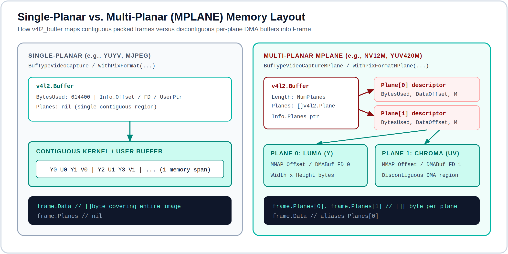

# Formats, Multi-Planar, Selection & Metadata

Negotiating how a camera, ISP, or capture card lays out pixel bytes is essential before allocating streaming buffers. Drivers can store pixels in one contiguous array (`PixFormat`), split YUV planes across separate discontiguous buffers (`PixFormatMPlane`), crop or compose sub-regions (`Selection`), stream out-of-band sensor/3A statistics (`MetaFormat`), and report display sink timing via HDMI EDID (`EDID`).



## Single-planar pixel formats

Single-planar devices expose one contiguous memory buffer per frame. Enumerate supported formats on an open `Device` with `GetFormatDescriptions()`, then read or update `v4l2.PixFormat`:

```go
descs, err := dev.GetFormatDescriptions()
if err == nil {
	for _, d := range descs {
		fmt.Printf("Format: %s (FourCC=0x%08x)\n", d.Description, d.PixelFormat)
	}
}

pix, err := dev.GetPixFormat()
if err != nil {
	log.Fatal(err)
}
pix.Width = 1280
pix.Height = 720
pix.PixelFormat = v4l2.PixelFmtYUYV
if err := dev.SetPixFormat(pix); err != nil {
	log.Fatal(err)
}
```

Use `v4l2.GetFormatFrameSizes` and `v4l2.GetFormatFrameInterval` when you need the exact discrete resolutions or stepwise min/max ranges paired with each pixel format. Common FourCC constants include `PixelFmtMJPEG`, `PixelFmtYUYV`, `PixelFmtNV12`, `PixelFmtYUV420`, `PixelFmtRGB24`, `PixelFmtH264`, and `PixelFmtHEVC`.

## Multi-planar (`MPLANE`) capture and output

Many embedded ISPs and hardware codecs implement V4L2's multi-planar API (`V4L2_BUF_TYPE_VIDEO_CAPTURE_MPLANE` and `OUTPUT_MPLANE`) so luma (`Y`), chroma (`UV`/`U`/`V`), or compression planes reside in independently stride-aligned DMA allocations.

Configure a `Device` for multi-planar capture with `WithBufferType` and `WithPixFormatMPlane`:

```go
dev, err := device.Open(
	"/dev/video10",
	device.WithBufferType(v4l2.BufTypeVideoCaptureMPlane),
	device.WithBufferSize(4),
	device.WithPixFormatMPlane(v4l2.PixFormatMPlane{
		Width:       1920,
		Height:      1080,
		PixelFormat: v4l2.PixelFmtNV12M,
		NumPlanes:   2,
	}),
)
if err != nil {
	log.Fatal(err)
}
defer dev.Close()

pixM, err := dev.GetPixFormatMPlane()
if err != nil {
	log.Fatal(err)
}
for i := uint8(0); i < pixM.NumPlanes; i++ {
	pf := pixM.PlaneFmt[i]
	fmt.Printf("Plane[%d]: stride=%dB size=%dB\n", i, pf.BytesPerLine, pf.SizeImage)
}
```

During streaming (`dev.Frames(ctx)` or `dev.GetFrames()`), `frame.Planes` holds a `[][]byte` slice containing one `[]byte` per active plane (and `frame.Data` aliases `frame.Planes[0]` when present). On output nodes configured with `BufTypeVideoOutputMPlane`, pass plane slices in order to `dev.WriteFramePlanes(ctx, planes)`.

To export multi-planar DMA-BUF file descriptors per plane directly at the UAPI layer, call `v4l2.ExportBufferPlane(dev.Fd(), bufType, index, planeIndex, flags)`. See `examples/mplane_device/` and `examples/mplane_capture/`.

## Selection rectangles (crop and compose)

Drivers implement cropping, native sensor readouts, and hardware scaler composition using `VIDIOC_G_SELECTION` and `VIDIOC_S_SELECTION`. Query or update rectangles directly via `v4l2.GetSelection` and `v4l2.SetSelection`:

```go
bounds, err := v4l2.GetSelection(dev.Fd(), v4l2.BufTypeVideoCapture, v4l2.SelTargetCropBounds)
if err == nil {
	sel, err := v4l2.SetSelection(dev.Fd(), v4l2.Selection{
		Type:   v4l2.BufTypeVideoCapture,
		Target: v4l2.SelTargetCrop,
		Rect: v4l2.Rect{
			Left:   bounds.Rect.Left + 160,
			Top:    bounds.Rect.Top + 120,
			Width:  bounds.Rect.Width - 320,
			Height: bounds.Rect.Height - 240,
		},
	})
	if err == nil {
		fmt.Printf("Driver applied crop: %+v\n", sel.Rect)
	}
}
```

Drivers often snap requested crop dimensions to hardware alignment boundaries and return the effective coordinates in the returned `v4l2.Selection`. Common targets include `SelTargetCrop`, `SelTargetCropDefault`, `SelTargetCropBounds`, `SelTargetCompose`, and `SelTargetNativeSize`. See `examples/selection_crop/`.

## Metadata format streams (`MetaFormat`)

CSI-2 camera receivers, USB UVC payload headers, and ISPs expose dedicated `/dev/video*` metadata nodes reporting `V4L2_CAP_META_CAPTURE` or `V4L2_CAP_META_OUTPUT` (for embedded sensor lines or 3A statistics buffers). Inspect and configure metadata streams directly using `GetMetaFormat`, `TryMetaFormat`, and `SetMetaFormat`:

```go
metaFmt, err := v4l2.GetMetaFormat(fd, v4l2.BufTypeMetaCapture)
if err == nil {
	fmt.Printf("Meta format: %s (size=%d)\n", metaFmt.String(), metaFmt.BufferSize)
}
```

Check `metaFmt.BufferSize` before allocating ring buffers for metadata nodes. Recognized `v4l2.MetaFmt*` constants cover UVC headers (`MetaFmtUVC`), Raspberry Pi BCM2835/PiSP stats and configs (`MetaFmtBCM2835ISPStats`, `MetaFmtRPiFEStats`, `MetaFmtRPiFECfg`, `MetaFmtRPiBECfg`), and Rockchip RKISP1 (`MetaFmtRKISP1Params`, `MetaFmtRKISP1Stat3A`). See `examples/meta_capture/`.

## HDMI & DisplayPort EDID management

HDMI receivers and transmitters expose Extended Display Identification Data (`EDID`) blocks via video nodes (`VIDIOC_G_EDID` / `VIDIOC_S_EDID`) or sub-device nodes (`VIDIOC_SUBDEV_G_EDID` / `VIDIOC_SUBDEV_S_EDID`).

Pass `blocks=0` to query how many 128-byte EDID blocks a device currently reports before reading them:

```go
probe, err := v4l2.GetEDID(fd, 0, 0, 0)
if err == nil && probe.Blocks > 0 {
	edid, err := v4l2.GetEDID(fd, 0, 0, probe.Blocks)
	if err == nil {
		fmt.Printf("Read %d EDID blocks (%d bytes)\n", edid.Blocks, len(edid.Data))
	}
}
```

To push a custom EDID table to a receiver sink or sub-device pad, call `v4l2.SetEDID` or `v4l2.SetSubdevEDID` (pass `Blocks: 0` to clear an active EDID).
