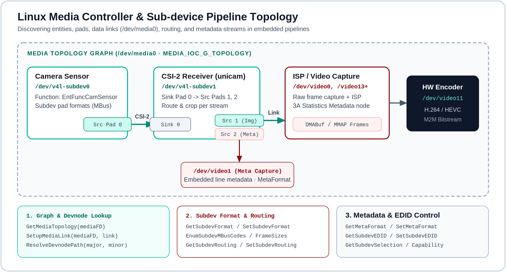

# Media Controller & Sub-devices

Modern embedded camera hardware rarely presents a single self-contained `/dev/video0` node. Instead, MIPI CSI-2 sensors, deserializers, hardware receivers, image signal processors (ISPs), and encoders form a pipeline graph exposed through a `/dev/media*` controller alongside one or more `/dev/v4l-subdev*` control nodes. The `v4l2` package provides native `CGO_ENABLED=0` support for querying topologies, toggling links, configuring pad formats, and managing sub-device stream routing.



## Inspecting `/dev/media*` topology graphs

Start from a Media Controller device node (`/dev/media0`) to discover every entity in the pipeline, see which character device interfaces belong to each entity, and inspect active or disabled pad links:

```go
mfd, err := v4l2.OpenDevice("/dev/media0", sys.O_RDWR|sys.O_CLOEXEC, 0)
if err != nil {
	log.Fatal(err)
}
defer v4l2.CloseDevice(mfd)

info, err := v4l2.GetMediaDeviceInfo(mfd)
if err != nil {
	log.Fatal(err)
}
fmt.Printf("Media: driver=%s model=%s\n", info.Driver, info.Model)

topo, err := v4l2.GetMediaTopology(mfd)
if err != nil {
	log.Fatal(err)
}
for _, ent := range topo.Entities {
	fmt.Printf("Entity %d: %s\n", ent.ID, ent.Name)
	for _, intf := range topo.EntityInterfaces(ent.ID) {
		nodePath, _ := v4l2.ResolveDevnodePath(intf.Major, intf.Minor)
		fmt.Printf("  node=%s\n", nodePath)
	}
}
```

`GetMediaTopology` issues the two-phase `MEDIA_IOC_G_TOPOLOGY` protocol automatically (first sizing entity/interface/pad/link arrays, then filling pinned slices cleanly). Helper methods on `MediaTopology`—`FindEntityByName`, `FindEntitiesByFunction`, `EntityPads`, `EntityInterfaces`, `PadLinks`, `DataLinks`, and `InterfaceLinks`—let you traverse the graph without manual ID bookkeeping. Calling `ResolveDevnodePath(intf.Major, intf.Minor)` resolves character device major/minor pairs through `/sys/dev/char/...` directly to paths such as `/dev/video0` or `/dev/v4l-subdev0`.

To enable or disable a mutable pipeline link between a source pad and a sink pad, pass a populated `MediaLinkDesc` to `v4l2.SetupMediaLink(mfd, link)` (`MEDIA_IOC_SETUP_LINK`). See `examples/media_topology/`.

## Negotiating `/dev/v4l-subdev*` pad formats and selections

Once you locate a sensor or CSI-2 bridge sub-device node (such as `/dev/v4l-subdev0`), open it directly to inspect supported media-bus pixel codes, discrete frame sizes, frame intervals, pad selections, and active vs. try formats:

```go
sfd, err := v4l2.OpenDevice("/dev/v4l-subdev0", sys.O_RDWR|sys.O_CLOEXEC, 0)
if err != nil {
	log.Fatal(err)
}
defer v4l2.CloseDevice(sfd)

// Inspect the active format on pad 0
fmtPad, err := v4l2.GetSubdevFormat(sfd, 0, v4l2.SubdevFormatActive)
if err != nil {
	log.Fatal(err)
}
fmt.Printf("Pad 0: %dx%d mbus=0x%04x (%s)\n",
	fmtPad.Format.Width, fmtPad.Format.Height,
	fmtPad.Format.Code, v4l2.MBusFormatNames[fmtPad.Format.Code])

// Enumerate supported media-bus codes on pad 0
codes, err := v4l2.EnumSubdevMBusCodes(sfd, 0, v4l2.SubdevFormatActive)
if err == nil {
	for _, c := range codes {
		fmt.Printf("Supported MBus: 0x%04x (%s)\n", c.Code, v4l2.MBusFormatNames[c.Code])
	}
}
```

Use `v4l2.SubdevFormatTry` when negotiating configurations without mutating live hardware state, then pass `v4l2.SubdevFormatActive` with `SetSubdevFormat` to commit validated widths, heights, colorspaces, and `MBusFormatCode` values. For sensor readout cropping and native pixel-array queries, call `v4l2.GetSubdevSelection` / `v4l2.SetSubdevSelection` with `SelTargetNativeSize`, `SelTargetCropBounds`, or `SelTargetCrop`. See `examples/subdev_pipeline/`.

## Sub-device capabilities and multiplexed stream routing

For CSI-2 multiplexers, virtual channels, and multi-stream sub-devices (such as embedded metadata alongside pixel frames), Linux V4L2 exposes capability probing, stream-aware client flags, and routing tables:

```go
cap, err := v4l2.GetSubdevCapability(sfd)
if err == nil && cap.SupportsStreams() {
	// Advertise stream-aware client support before configuring routes
	_, _ = v4l2.SetSubdevClientCapability(sfd, v4l2.SubdevClientCapStreams)

	routes, err := v4l2.GetSubdevRouting(sfd, v4l2.SubdevFormatActive)
	if err == nil {
		for _, r := range routes {
			fmt.Printf("Route: sink=%d/%d -> src=%d/%d active=%v\n",
				r.SinkPad, r.SinkStream, r.SourcePad, r.SourceStream, r.IsActive())
		}
	}
}
```

Calling `SetSubdevClientCapability(sfd, v4l2.SubdevClientCapStreams)` tells kernel sub-device drivers that your process understands stream IDs when calling `GetSubdevRouting` (`VIDIOC_SUBDEV_G_ROUTING`) or updating active routes via `SetSubdevRouting` (`VIDIOC_SUBDEV_S_ROUTING`).
