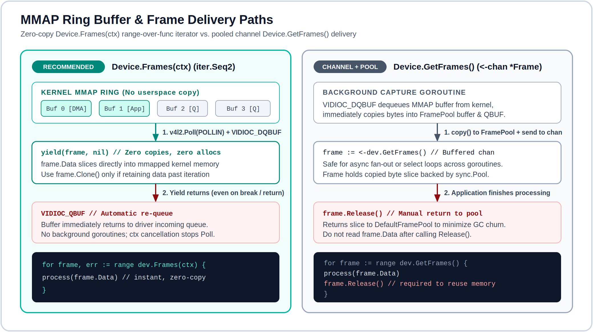

# Streaming, I/O & Zero-Copy

High-throughput video pipelines cannot afford allocating and copying multi-megabyte frame buffers on every frame tick. `go4vl` provides two streaming APIs—a zero-copy `iter.Seq2` iterator and a pooled channel pipeline—alongside four V4L2 I/O mechanisms (`MMAP`, `UserPtr`, `DMA-BUF`, and `Read`/`Write`), video output streaming, and `poll`/`epoll` readiness waiting.



## Zero-copy capture with `Device.Frames(ctx)`

`Device.Frames(ctx)` is the primary way to read captured frames in `go4vl`. Unlike the older channel capture loop, `Frames(ctx)` spawns **zero background goroutines** and performs **zero per-frame heap copies**:

```go
if err := dev.Start(ctx); err != nil {
	log.Fatal(err)
}
defer dev.Stop()

for frame, err := range dev.Frames(ctx) {
	if err != nil {
		if errors.Is(err, context.Canceled) {
			break
		}
		log.Fatalf("frame error: %v", err)
	}

	// Zero-copy access to the kernel MMAP buffer.
	processPixels(frame.Data)
}
```

Inside each iteration:

1. `Frames(ctx)` waits synchronously using `v4l2.Poll` with `PollIn`, responding immediately to context cancellation.
2. When ready, it dequeues one filled buffer (`VIDIOC_DQBUF`) and constructs a `*device.Frame` whose `Data` slice (or `Planes` slices in `MPLANE` mode) points straight into the mapped buffer.
3. As soon as your loop body finishes an iteration—or exits early via `break` or `return`—`Frames(ctx)` automatically re-queues the buffer via `VIDIOC_QBUF`.

Because kernel buffers wrap around as soon as they are re-queued, call `frame.Clone()` whenever you need to retain frame bytes past the current loop body. Do **not** call `Frames(ctx)` and `GetFrames()` simultaneously on the same started `Device`.

## Pooled channel capture with `Device.GetFrames()`

When your architecture routes frames across multiple worker goroutines or multiplexes frame arrivals with other Go channels using `select`, call `dev.GetFrames()`. `GetFrames()` starts a capture goroutine that copies each dequeued kernel buffer into a buffer checked out from `FramePool`, immediately returns the kernel buffer to the driver, and sends the pooled `*Frame` on `<-chan *Frame`:

```go
for {
	select {
	case <-ctx.Done():
		return
	case frame, ok := <-dev.GetFrames():
		if !ok {
			return
		}
		handleFrame(frame.Data)
		frame.Release() // return slice to FramePool to avoid GC pressure
	case err := <-dev.GetError():
		log.Printf("capture error: %v", err)
	}
}
```

Always call `frame.Release()` after processing completes so the underlying byte slice returns to `DefaultFramePool()`. Calling `Release()` multiple times on the same `*Frame` is a safe no-op, but never read `frame.Data` after releasing it.

## Selecting an I/O mode (`MMAP`, `UserPtr`, `DMA-BUF`, `Read`/`Write`)

Memory-mapped streaming (`v4l2.IOTypeMMAP`) is the default because kernel drivers allocate DMA-capable buffers and expose them without copies. You can opt into alternative Linux V4L2 I/O modes using `device.WithIOType` and `device.WithIOMethod`:

* **User Pointer (`device.WithIOType(v4l2.IOTypeUserPtr)`):** Allocates userspace buffers (`v4l2.AllocateUserBuffers`) and passes page pointers to drivers capable of scatter-gather DMA into application memory. See `examples/userptr_capture/`.
* **DMA-BUF (`device.WithIOType(v4l2.IOTypeDMABuf)`):** Shares kernel DMA buffers across V4L2 devices, GPU textures, or DRM planes via file descriptors without CPU copies. Export MMAP buffers using `dev.ExportBuffer(index, flags)` (or `v4l2.ExportBufferPlane` for multi-planar) or register external DMA-BUF FDs via `dev.AddDMABufferFDs(fds...)`. See `examples/dmabuf_export/`.
* **Direct Read/Write (`device.WithIOMethod(device.IOMethodReadWrite)`):** For legacy drivers lacking streaming ring support, read and write directly via `dev.ReadContext(ctx, buf)` / `dev.WriteContext(ctx, buf)`. See `examples/readwrite_capture/`.

## Video output streaming (`WriteFrame` and `WriteFramePlanes`)

To push frames into a hardware output device or a `v4l2loopback` virtual webcam, open the node with `device.WithVideoOutputEnabled()`, start it, and call `dev.WriteFrame(ctx, frameBytes)` (or `dev.WriteFramePlanes(ctx, planes)` for `BufTypeVideoOutputMPlane`):

```go
dev, err := device.Open(
	"/dev/video10",
	device.WithVideoOutputEnabled(),
	device.WithBufferSize(4),
	device.WithPixFormat(v4l2.PixFormat{
		Width: 640, Height: 480, PixelFormat: v4l2.PixelFmtYUYV,
	}),
)
if err != nil {
	log.Fatal(err)
}
defer dev.Close()

if err := dev.Start(ctx); err != nil {
	log.Fatal(err)
}
defer dev.Stop()

if err := dev.WriteFrame(ctx, rawYUYVBytes); err != nil {
	log.Fatal(err)
}
```

`WriteFrame` fills all pre-allocated output buffers first, then waits for free buffers via `v4l2.Poll(ctx, d.fd, v4l2.PollOut, ...)` and dequeues completed frames automatically before copying your payload into the next slot and queueing it back to the kernel. See `examples/video_output/`.

## Timestamps and dynamic buffer lifecycle

Linux V4L2 drivers typically tag captured frames using `CLOCK_MONOTONIC` rather than wall-clock UTC time. Pass `device.WithTimestampMode` to control how `Frame.Timestamp` is computed:

* `v4l2.TimestampDefault` — interprets `timeval` directly (`time.Unix`).
* `v4l2.TimestampAuto` — inspects buffer flags (`BufFlagTimestampMonotonic`) and adjusts monotonic timestamps into wall-clock `time.Time`.
* `v4l2.TimestampMonoToAbs` — always converts monotonic kernel timestamps to wall-clock `time.Time`.

At the low-level `v4l2` layer, you can also prepare buffers off the hot path with `v4l2.PrepareBuffer` (`VIDIOC_PREPARE_BUF`), allocate extra buffers during active streaming via `v4l2.CreateBuffers` (`VIDIOC_CREATE_BUFS`), and release buffers on Linux 6.10+ via `v4l2.RemoveBuffers` (`VIDIOC_REMOVE_BUFS`).

## Readiness polling with `v4l2.Poll` and `v4l2.Poller`

For single-device readiness checks without goroutines, call `v4l2.Poll(ctx, fd, v4l2.PollIn|v4l2.PollOut|v4l2.PollPri, timeout)`. When orchestrating multiple file descriptors at once—such as an M2M decoder `fd`, a `MediaRequest` `fd`, and an input capture device—use `v4l2.Poller`, which wraps Linux `epoll` with an internal `eventfd` so `ctx` cancellation wakes `Wait` immediately:

```go
poller, err := v4l2.NewPoller()
if err != nil {
	log.Fatal(err)
}
defer poller.Close()

_ = poller.Add(dev.Fd(), v4l2.PollIn|v4l2.PollPri)
results := make([]v4l2.PollResult, 4)
n, err := poller.Wait(ctx, results, 100*time.Millisecond)
```

Each entry in `results[:n]` identifies the ready file descriptor and bitmask (`PollIn`, `PollOut`, `PollPri`, `PollErr`, `PollHup`).
